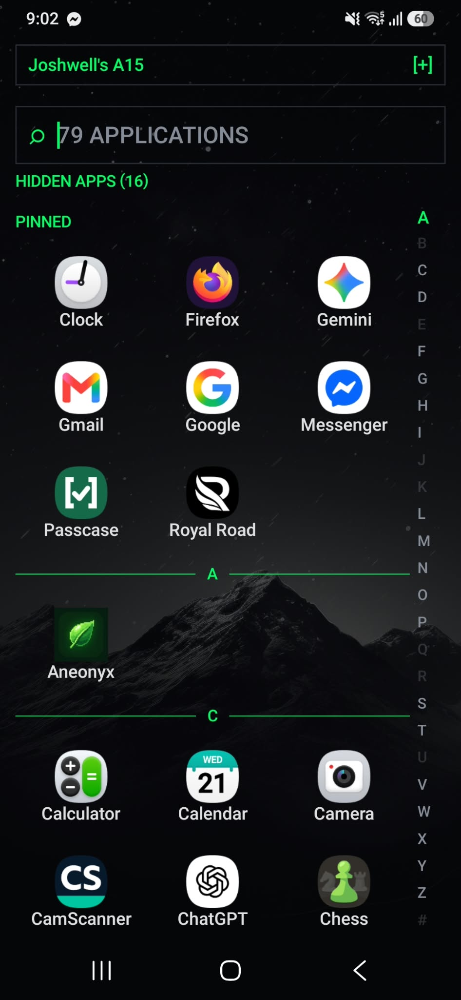
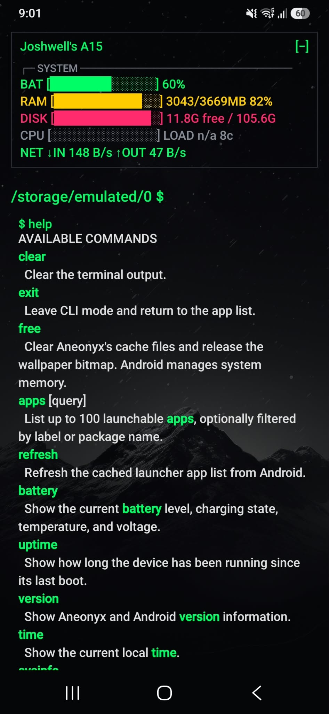
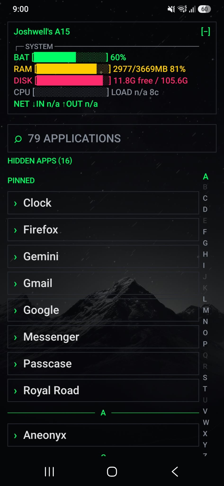

# ⌘ Aneonyx

A minimal Android home launcher with a **clean, terminal-style interface**.

Aneonyx brings a shell-like prompt, a searchable text-first app list, a collapsible system readout, and your blurred wallpaper to your Android home screen. In CLI mode, the prompt shows the current directory and updates after `cd`. The terminal accepts Aneonyx's built-in commands; it is not an unrestricted Android or Linux shell.

**Next release:** 2.0.0 (version code 3) · **Minimum Android version:** Android 6.0 (API 23)

<p align="center">
  
</p>

> **A focused, text-first home screen for Android.**

## 📸 Screenshots

<p align="center">
  
  
  
  
</p>

---

## ✨ Features

### ⌨️ Terminal-inspired home screen

* A standard app search bar in home mode; the current-directory prompt appears in CLI mode and updates after `cd`
* Text-first app rows without app icons
* Live app count and a search field for filtering installed apps
* Type `/` in the app search field to enter CLI mode, then run built-in commands such as `ls`, `cd`, `pwd`, and `help` without a leading slash. The interface shows a directory prompt and scrollable command transcript.
* Built-in commands: `clear`, `exit`, `free`, `apps`, `refresh`, `battery`, `uptime`, `version`, `ps`, `pwd`, `mkdir`, `rmdir`, `rm`, `find`, `open`, `uninstall`, `grep`, `calc`, `time`, `sysinfo`, `pkg`, `clip`, `ls`, `cd`, `cat`, `favorites`, `pin`, `unpin`, `hide`, `unhide`, `theme`, `history`, `layout`, and `help`. Run `exit` to return to the app list.
* Long-press an app for actions to add/remove it from favorites, open Android App Info, or hide/unhide it. Favorites and hidden app choices persist across launches; `pin`, `unpin`, `hide`, and `unhide` are also available as commands.
* Pinned apps stay in a **PINNED** section above the alphabetical app list. Hidden apps leave the app list and search; use **HIDDEN APPS** or `unhide <app>` to restore them. The `favorites` command lists pinned apps.
* Change the accent color with `theme list` and `theme <name>`. Presets include green (the default), blue, violet, amber, rose, and white; the choice persists across launches.
* Double-tap the launcher background to lock the screen. Android asks you to enable Aneonyx as a device administrator the first time; this access is used only for the lock gesture.
* The terminal keeps up to 20 command results, with the newest at the top and older results below; `clear` empties the output. `free` clears Aneonyx's cache files and releases the wallpaper bitmap.
* A file browser for shared storage Android makes available to the app: `ls [--page <number>] [subfolder]` lists every visible file and folder, including dotfiles, 80 entries at a time; `cd <directory>` changes the prompt path, and `pwd`, `mkdir <directory>`, `rmdir --confirm <directory>`, `rm --confirm <file>`, `find <query>` (up to 5,000 entries), `grep <pattern> <file>` (up to 20,000 lines/200 matches), and `cat <filename>` work from the current directory (text reads capped at 1 MiB)
* The last 20 successful commands persist locally; `history clear` deletes the saved history
* `layout grid` and `layout list` switch between a three-column app grid and the compact list, with the choice saved across launches
* Tap the RAM readout to refresh telemetry; Android manages garbage collection automatically
* Apps grouped under sticky alphabetical headings, with a draggable A–Z rail that jumps to the nearest available section
* Press the keyboard's **Search** action to open the first matching app
* The launcher refreshes its app list when apps are installed, removed, or updated
* The selected system wallpaper displayed with a blur behind the launcher

### 📊 Collapsible device telemetry panel

Open the panel's **SYSTEM** section to view device readouts:

* 🔋 Battery level and charging state
* 🧠 Device RAM usage
* 💾 Shared internal storage usage and free space
* ⚙️ CPU load average and available core count
* 🌐 Device-wide network receive and transmit rates

The panel stays idle while collapsed and samples only while the launcher is visible. RAM and network readings refresh every five seconds, CPU load every 15 seconds, and battery and disk readings every 30 seconds. Network rates are based on device-wide traffic counters. The CPU bar is a normalized load-average estimate, not a direct CPU utilization reading.

Commands run only when you press the keyboard's **Search** action. `help` describes each command. This terminal runs Aneonyx's built-in local commands; it does not execute arbitrary Android or Linux shell commands. `apps [query]` searches the cached launchable-app list, and `refresh` requests a fresh package-manager query. `battery`, `uptime`, and `version` show local Android device/app information without network access. `sysinfo` reports the system details Android exposes to the app, including RAM and storage totals and use. Deletion commands require an explicit `--confirm` argument and remain limited to shared storage exposed to the app. `free` clears Aneonyx's own cache files and drops transient launcher references; Android decides when heap memory is reclaimed and manages other apps' RAM and caches.

The command list is not a general-purpose shell. `ps` reports only processes Android makes visible. `uninstall` opens Android's confirmation screen. Clipboard access occurs only when you run `clip`.

Android's scoped-storage rules may prevent direct file access to shared storage on newer Android versions. The file commands report inaccessible paths instead of requesting broad all-files access; use Android's file picker for locations protected by the system. File previews are capped at 20 lines/1 MiB to limit memory use. Actual launcher memory use depends on Android, the device, wallpaper size, and installed apps, so a fixed RAM ceiling cannot be guaranteed.

---

## 📱 Install on Android

Download the signed APK from the [latest GitHub Release](https://github.com/llewtonsi/aneonyx/releases/latest) and open it on your phone. Android may ask you to allow installs from that source. The APK is distributed directly; Aneonyx is not currently published on Google Play.

Then make Aneonyx your home app:

1. Open **Settings** on your phone.
2. Go to **Apps → Default apps → Home app**. Menu names can vary by device.
3. Select **Aneonyx**.

The Android application ID is `com.llewtonsi.aneonyx`. Builds using the earlier placeholder ID install as a separate app; their private preferences are not migrated to this ID.

Press the Home button to use it. You can switch back to another launcher from the same setting.

---

## 🚀 Build from source

### Requirements

* JDK 17
* Android SDK Platform 35 and Android build tools
* Android 6.0 (API 23) or later to install the app

Clone the repository and build the debug APK:

```bash
git clone https://github.com/llewtonsi/aneonyx.git
cd aneonyx
./gradlew assembleDebug
```

The debug APK is created at `app/build/outputs/apk/debug/app-debug.apk`.

The optimized, minified release APK can be built with `./gradlew assembleRelease`. When `keystore.properties` points to a valid private release keystore, Gradle signs the APK and copies it to `app/release/Aneonyx.apk`; without that configuration, Gradle produces an unsigned APK at `app/build/outputs/apk/release/app-release-unsigned.apk`. Keep the keystore and passwords private and outside Git. Upload the signed APK manually to GitHub Releases; there is no automated publishing workflow.

### Google Play release readiness

The current build targets API 35 and is not ready for Google Play submission. Google Play requires new apps and updates to target API 36 from 31 August 2026. Install Android SDK Platform 36, update the compatible Android Gradle Plugin/Gradle versions, then rerun tests and build the release App Bundle. See Google's [target API policy](https://support.google.com/googleplay/android-developer/answer/11926878) and [app signing guide](https://developer.android.com/studio/publish/app-signing).

To install the generated APK on a connected device with USB debugging enabled:

```bash
adb install -r app/build/outputs/apk/debug/app-debug.apk
```

You can also open the project in Android Studio, sync Gradle, and run the `app` configuration on a connected phone or emulator.

---

## 🛠️ Built with

* **Kotlin** — application code
* **Jetpack Compose** — user interface
* **Android SDK** — launcher, app discovery, and device information
* **Gradle** — build system

---

## 🤝 Contributing

Bug reports, ideas, and non-commercial code contributions are welcome. Before making a larger change, open an issue to discuss it. Pull requests are reviewed before they are merged; submitting one does not guarantee acceptance.

Please make sure you have permission to contribute any code or assets you submit. Contributions and redistribution remain subject to the project license below.

---

## 📜 License and usage

Aneonyx is provided under the **[PolyForm Noncommercial License 1.0.0](LICENSE)**, the same license used by [Veinfall](https://github.com/llewtonsi/veinfall).

Under its terms, you may study, modify, and share Aneonyx for non-commercial purposes. **Commercial use, including selling the app or using it for a commercial purpose, requires separate permission from the copyright holder.** Third-party dependencies remain under their own licenses.

This is source-available software under a non-commercial license, rather than open source under the standard Open Source Definition, because commercial use is restricted. Read the full [LICENSE](LICENSE) for the applicable terms.

---

⭐ **Thanks for checking out Aneonyx!**
