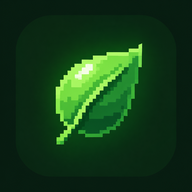

# ⌘ VixLauncher

A minimal Android home launcher with a **clean, terminal-style interface**.

VixLauncher brings a shell-like prompt, a searchable text-first app list, a collapsible system readout, and your blurred wallpaper to your Android home screen. The prompt uses the device's available user and device names instead of a hard-coded identity. The terminal accepts VixLauncher's built-in commands; it is not an unrestricted Android or Linux shell.

**Current release:** 1.0.1 (version code 2) · **Minimum Android version:** Android 6.0 (API 23)

<p align="center">
  
</p>

> **A focused, text-first home screen for Android.**

---

## ✨ Features

### ⌨️ Terminal-inspired home screen

* A shell-style prompt that reads the available Android profile name and device name
* Text-first app rows without app icons
* Live app count and a search field for filtering installed apps
* Local terminal commands from the search field: `/clear`, `/free`, `/apps`, `/refresh`, `/battery`, `/uptime`, `/version`, `/ps`, `/kill`, `/pwd`, `/mkdir`, `/rmdir`, `/rm`, `/find`, `/open`, `/uninstall`, `/grep`, `/calc`, `/time`, `/sysinfo`, `/pkg`, `/clip`, `/dnd`, `/ls`, `/cd`, `/cat`, `/history`, `/layout`, and `/help`
* Terminal output retains up to 20 command results and 8,000 characters per result; `/clear` clears it and `/free` reports VixLauncher's managed heap usage without forcing garbage collection
* A bounded file browser for storage locations Android makes available to the app: `/ls [subfolder]`, `/cd <directory>`, `/pwd`, `/mkdir <directory>`, `/rmdir --confirm <directory>`, `/rm --confirm <file>`, `/find <query>`, `/grep <pattern> <file>`, and `/cat <filename>` (text reads capped at 1 MiB)
* The last 20 successful slash commands persist locally; `/history clear` deletes the saved history
* `/layout grid` and `/layout list` switch between a three-column app grid and the compact list, with the choice saved across launches
* Tap the RAM readout to refresh telemetry; Android manages garbage collection automatically
* Apps grouped under sticky alphabetical headings, with a draggable A–Z rail that jumps to the nearest available section
* Press the keyboard's **Search** action to open the first matching app
* Long-press an app to open its Android app info page
* The launcher refreshes its app list when apps are installed, removed, or updated
* The selected system wallpaper displayed with a blur behind the launcher

### 📊 Collapsible `SYSTEM` panel

Open the panel's **INFO** section to view device readouts:

* 🔋 Battery level and charging state
* 🧠 Device RAM usage
* 💾 Shared internal storage usage and free space
* ⚙️ CPU load average and available core count
* 🌐 Device-wide network receive and transmit rates

The panel stays idle while collapsed and samples only while the launcher is visible. RAM and network readings refresh every five seconds, CPU load every 15 seconds, and battery and disk readings every 30 seconds. Network rates are based on device-wide traffic counters. The CPU bar is a normalized load-average estimate, not a direct CPU utilization reading.

Terminal commands run only when you press the keyboard's **Search** action. `/help` describes each command. `/apps [query]` searches the cached launchable-app list, and `/refresh` requests a fresh package-manager query. `/battery`, `/uptime`, and `/version` show local Android device/app information without network access. Deletion commands require an explicit `--confirm` argument and remain limited to shared storage exposed to the app. `/free` reports the managed heap snapshot; Android controls garbage collection. `/dnd` toggles Do Not Disturb and requires notification-policy access in Android Settings. It does not schedule timed DND; use Android Quick Settings for that.

The command list is not a general-purpose shell. `/ps` reports only processes Android makes visible, and `/kill` opens App Info because Android does not let launchers force-stop other apps. `/uninstall` opens Android's confirmation screen. Clipboard access occurs only when you run `/clip`.

Android's scoped-storage rules may prevent direct file access to shared storage on newer Android versions. The file commands report inaccessible paths instead of requesting broad all-files access; use Android's file picker for locations protected by the system. Directory output is capped at 200 entries, and file previews at 20 lines/1 MiB to limit memory use. Actual launcher memory use depends on Android, the device, wallpaper size, and installed apps, so a fixed RAM ceiling cannot be guaranteed.

---

## 📱 Install on Android

Download the signed APK from the [latest GitHub Release](https://github.com/llewtonsi/vixlauncher/releases/latest) and open it on your phone. Android may ask you to allow installs from that source. The APK is distributed directly; VixLauncher is not currently published on Google Play.

Then make VixLauncher your home app:

1. Open **Settings** on your phone.
2. Go to **Apps → Default apps → Home app**. Menu names can vary by device.
3. Select **VixLauncher**.

The Android application ID is `com.llewtonsi.vixlauncher`. Builds using the earlier placeholder ID install as a separate app; their private preferences are not migrated to this ID.

Press the Home button to use it. You can switch back to another launcher from the same setting.

---

## 🚀 Build from source

### Requirements

* JDK 17
* Android SDK Platform 35 and Android build tools
* Android 6.0 (API 23) or later to install the app

Clone the repository and build the debug APK:

```bash
git clone https://github.com/llewtonsi/vixlauncher.git
cd vixlauncher
./gradlew assembleDebug
```

The product-named debug APK is created at:

```text
app/build/outputs/vixlauncher/VixLauncher.apk
```

Gradle also keeps its standard debug APK at `app/build/outputs/apk/debug/app-debug.apk`.

The optimized, minified release APK can be built with `./gradlew assembleRelease` and is written to `app/build/outputs/apk/release/app-release-unsigned.apk`. This source repository does not contain the private release key, so the Gradle task produces an unsigned APK. To make a signed APK, use Android Studio's **Build → Generate Signed Bundle / APK → APK** flow and select the `release` build. Keep the keystore and passwords private and outside Git. The signed APK is uploaded manually to GitHub Releases; there is no workflow that automatically publishes debug builds.

### Google Play release readiness

The current build targets API 35 and is not ready for Google Play submission. Google Play requires new apps and updates to target API 36 from 31 August 2026. Install Android SDK Platform 36, update the compatible Android Gradle Plugin/Gradle versions, then rerun tests and build the release App Bundle. See Google's [target API policy](https://support.google.com/googleplay/android-developer/answer/11926878) and [app signing guide](https://developer.android.com/studio/publish/app-signing).

To install the generated APK on a connected device with USB debugging enabled:

```bash
adb install -r app/build/outputs/vixlauncher/VixLauncher.apk
```

You can also open the project in Android Studio, sync Gradle, and run the `app` configuration on a connected phone or emulator.

---

## 🛠️ Built with

* **Kotlin** — application code
* **Jetpack Compose** — user interface
* **Android SDK** — launcher, app discovery, and device information
* **Gradle** — build system

---

## 🤝 Contributing

Bug reports, ideas, and non-commercial code contributions are welcome. Before making a larger change, open an issue to discuss it. Pull requests are reviewed before they are merged; submitting one does not guarantee acceptance.

Please make sure you have permission to contribute any code or assets you submit. Contributions and redistribution remain subject to the project license below.

---

## 📜 License and usage

VixLauncher is provided under the **[PolyForm Noncommercial License 1.0.0](LICENSE)**, the same license used by [Veinfall](https://github.com/llewtonsi/veinfall).

Under its terms, you may study, modify, and share VixLauncher for non-commercial purposes. **Commercial use, including selling the app or using it for a commercial purpose, requires separate permission from the copyright holder.** Third-party dependencies remain under their own licenses.

This is source-available software under a non-commercial license, rather than open source under the standard Open Source Definition, because commercial use is restricted. Read the full [LICENSE](LICENSE) for the applicable terms.

---

⭐ **Thanks for checking out VixLauncher!**
